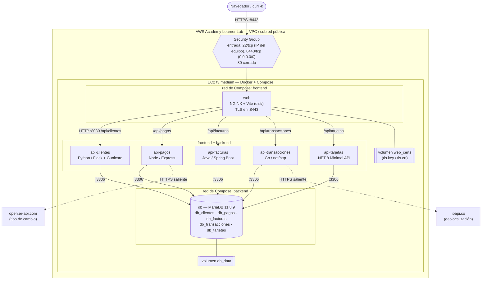
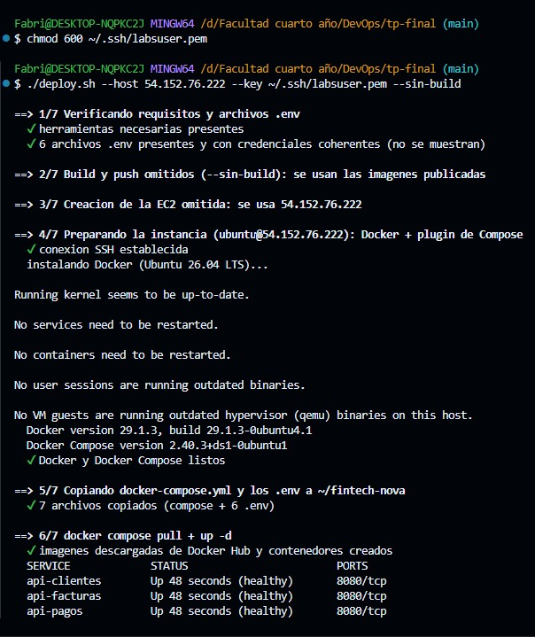
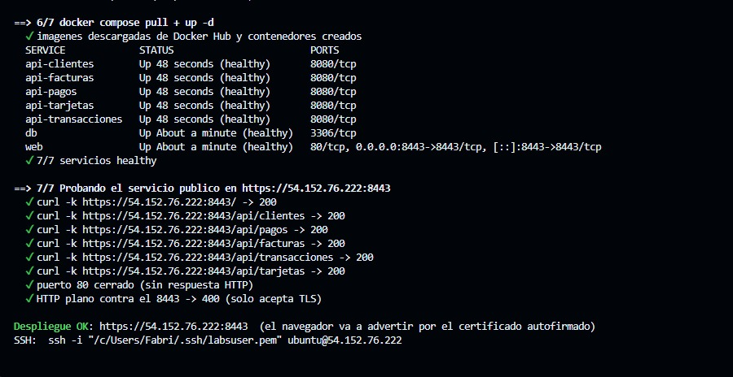
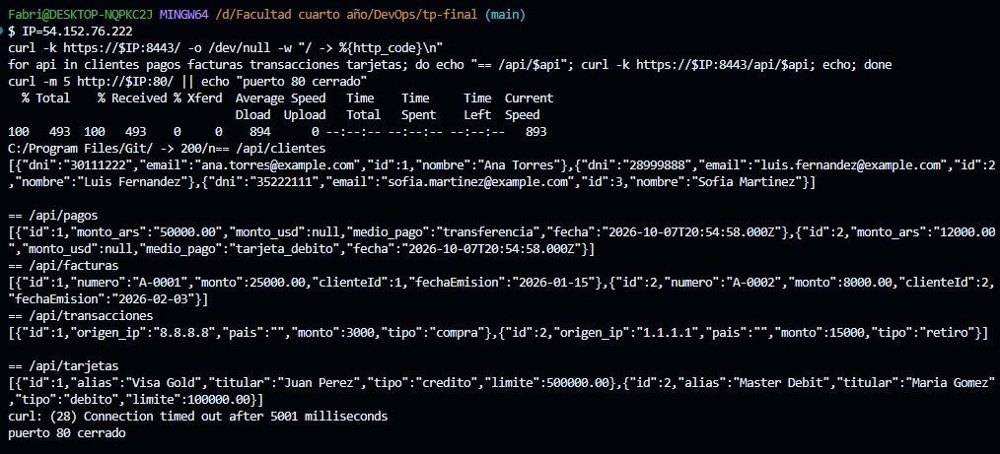
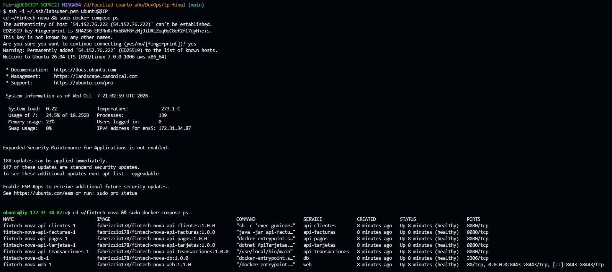
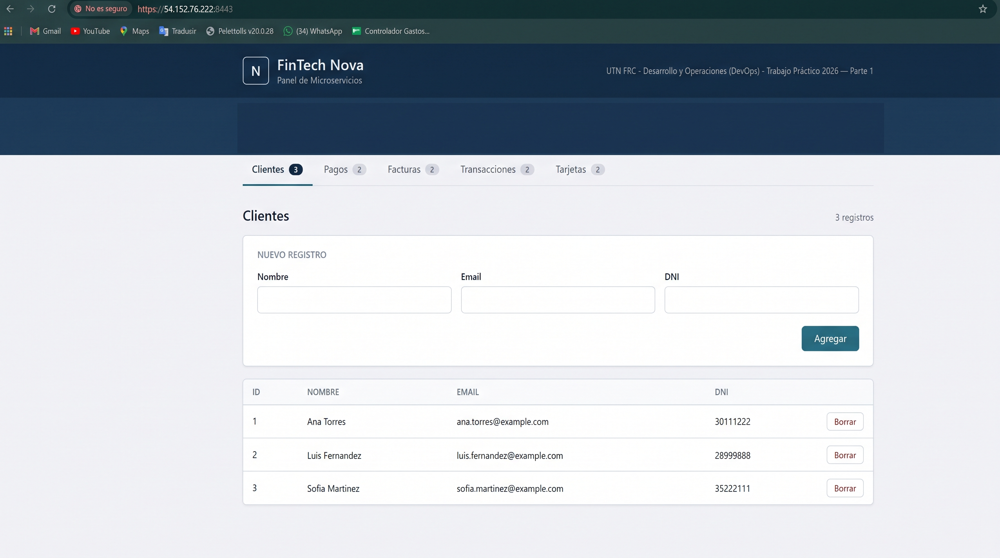
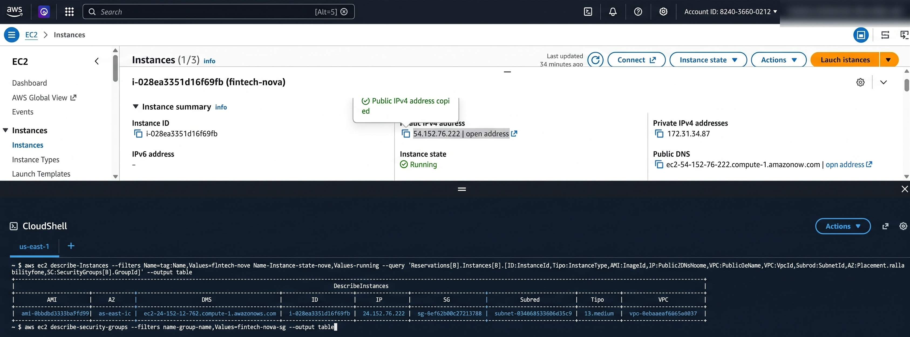

# FinTech Nova — Orquestación de Microservicios Políglotas y Despliegue en AWS EC2

Plataforma financiera distribuida con arquitectura de microservicios contenerizada, securizada y desplegada en la nube (AWS EC2).

## Introducción

FinTech Nova es una plataforma de microservicios **políglota**: cinco APIs REST, cada una en un
lenguaje distinto, más un frontend. Las APIs hacen el ABM de su entidad y comparten **una sola
instancia de MariaDB**, con una base por servicio. Recibimos el código funcionando sin Docker. El
trabajo fue:

1. Escribir un `Dockerfile` y un `.dockerignore` por componente (7 imágenes, incluida la base).
2. Publicar las imágenes en Docker Hub.
3. Orquestarlas con un único `docker-compose.yml` que solo usa imágenes publicadas.
4. Desplegar el stack en **una** instancia EC2 `t3.medium` del AWS Academy Learner Lab, con
   **HTTPS como única entrada**.

No modificamos la lógica de negocio. Los únicos cambios en el código de las APIs son
correcciones de seguridad, que están documentadas en [ERRORES.md](./ERRORES.md) y
[SEGURIDAD.md](./SEGURIDAD.md).

## Arquitectura desplegada

> Verificado contra el despliegue real del 2026-10-07 en la EC2 `i-028ea3351d16f69fb`
> (`54.152.76.222`, `us-east-1c`): 7 contenedores `healthy`, solo el 8443 publicado y el Security
> Group con 22 desde la IP del equipo y 8443 público. Ver [Evidencia de funcionamiento](#evidencia-de-funcionamiento).



Si el visor no muestra Mermaid, esta es la versión en texto:

```
Internet ──HTTPS :8443──► [Security Group: 22 desde IP del equipo, 8443 público, 80 cerrado]
                                   │
┌─ EC2 t3.medium ──────────────────┼───────────────────────────────────────────────────────┐
│  red "frontend" (web ↔ APIs)     ▼                                                       │
│                    ┌──────────────────────────────┐                                      │
│                    │ web: NGINX, TLS, :8443       │◄── volumen web_certs                 │
│                    └──────────────┬───────────────┘                                      │
│        /api/clientes  /api/pagos  /api/facturas  /api/transacciones  /api/tarjetas       │
│              ▼            ▼             ▼                ▼                 ▼             │
│        api-clientes   api-pagos    api-facturas   api-transacciones   api-tarjetas       │
│         (Python)       (Node) ─┐     (Java)          (Go) ─┐            (.NET)           │
│              │            │    │        │               │   │              │             │
│  red "backend" (APIs ↔ db)┴────┼────────┴───────────────┴───┼──────────────┘             │
│                                ▼  :3306                     │                            │
│                    db: MariaDB (5 bases) ◄── volumen db_data│                            │
└────────────────────────────────┼────────────────────────────┼────────────────────────────┘
                                 ▼ HTTPS saliente             ▼ HTTPS saliente
                         open.er-api.com                  ipapi.co
```

| Servicio | Imagen base (runtime) | Multistage | Usuario | Límites (CPU / memoria) | Puerto publicado |
|---|---|---|---|---|---|
| `web` | `nginx:1.30-alpine` (build con `node:22-alpine`) | Sí | `nginx` (101) | 0.25 / 64M | **8443** (único) |
| `api-clientes` | `python:3.12-slim` | Sí (venv) | `appuser` | 0.25 / 128M | — |
| `api-pagos` | `node:22-alpine` | No | `node` | 0.25 / 128M | — |
| `api-facturas` | `eclipse-temurin:21-jre-alpine` (build con Maven + JDK 21) | Sí | `appuser` | 0.50 / 512M | — |
| `api-transacciones` | `alpine:3.24.2` (build con `golang:1.27-alpine`) | Sí | `app` | 0.25 / 128M | — |
| `api-tarjetas` | `dotnet/aspnet:8.0-alpine` (build con el SDK) | Sí | `appuser` | 0.25 / 256M | — |
| `db` | `mariadb:11.8.9-ubi9` | No | el de la imagen oficial | 0.50 / 512M | — |

En total, los límites suman unos 1,7 GiB, dentro de los 4 GiB de la `t3.medium`. Así queda margen
para el sistema operativo, Docker y los picos de arranque de Java.

## Decisiones de diseño

- **Una sola entrada pública por HTTPS en 8443.** `web` (NGINX) sirve el frontend, termina TLS y
  reenvía cada `/api/<servicio>` a su API por la red interna, en HTTP plano. Ni las APIs ni
  MariaDB publican puertos. Elegimos 8443 y no 443 porque NGINX corre sin root, y sin root no
  puede abrir puertos menores a 1024. El puerto 80 no se usa en ningún lado: ni en NGINX, ni en
  Compose, ni en el Security Group.
- **Separación de redes (frontend y backend).** El contenedor `web` y las APIs se comunican por una red `frontend`, mientras que las APIs y MariaDB se comunican por una red `backend`. Las APIs conectan a ambas. Esto aplica el **principio de mínimo privilegio de red**: impide que el contenedor `web`, el único expuesto al exterior, pueda contactar directamente a `db:3306` en caso de ser comprometido.
- **Certificado autofirmado generado en runtime.** Al arrancar, el script
  `web/nginx/40-generar-certificado.sh` crea la clave y el certificado con OpenSSL dentro del
  volumen `web_certs`, si todavía no existen. La imagen pública no contiene ninguna clave privada y
  la clave nunca pasa por Git. Detalle en [SEGURIDAD.md](./SEGURIDAD.md#2-certificado-tls).
- **Una sola instancia de MariaDB con 5 bases.** `00-databases.sh` crea las bases y da permisos al
  usuario de aplicación, y los `.sql` numerados crean las tablas. Las APIs usan `DB_HOST=db`, el
  nombre del servicio en Compose, que el DNS interno de Docker resuelve.
- **Secretos fuera de Git y de las imágenes.** Cada componente tiene un `env.example` sin
  credenciales. Los `.env` reales los carga Compose con `env_file` y están excluidos en
  `.gitignore` y en cada `.dockerignore`.
- **Multistage donde hay compilación** (Java, Go, .NET y Vite). Así la imagen final no lleva
  compiladores, SDK ni `node_modules`.
- **Contenedores sin root, con HEALTHCHECK y `restart: always`.** Las APIs esperan a que `db`
  esté `healthy` (`depends_on: condition: service_healthy`).
- **Memoria de Java acotada.** `api-facturas` define `JAVA_TOOL_OPTIONS=-XX:MaxRAMPercentage=75
  -XX:+UseSerialGC`, así que la JVM calcula su heap sobre el límite del contenedor (512M) y no
  sobre los 4 GiB de la EC2.
- **NGINX resuelve las APIs en cada pedido** (`resolver 127.0.0.11`). Puede arrancar aunque falte
  una API (esa ruta responde 502) y no se queda con una IP vieja si se recrea un contenedor.
- **LF forzado con `.gitattributes`.** Con `core.autocrlf=true`, Git para Windows convertía los
  scripts a CRLF y MariaDB no inicializaba las bases (ver [ERRORES.md](./ERRORES.md)).
- **Imágenes parametrizadas con la cuenta de Docker Hub (`${DOCKERHUB_USER}`)**, con tags de versión fijos
  (`1.0.0`; `web` va por `1.2.0`, con la edición de registros). Con la variable `$DOCKERHUB_USER`, `deploy.sh`
  puede construir y publicar todo con un único `docker login`, y toma el tag de cada imagen de
  `docker-compose.yml`, así lo que publica es exactamente lo que la EC2 descarga.
- **Modificación de registros desde el mismo formulario.** El botón "Editar" de cada fila carga el
  registro en el formulario de alta y envía `PUT /api/<entidad>/<id>` (reemplazo completo, como lo
  define cada API). Si no cambió ningún campo, el front no envía nada: clientes y transacciones
  devuelven 404 a un PUT idéntico, porque su driver cuenta filas cambiadas y no filas coincidentes.
  Si el registro se borró mientras se editaba, el 404 saca del modo edición y recarga el listado.
- **Limitación conocida: el país de una transacción no se recalcula al editar.** El PUT guarda
  `pais` desde el body y no vuelve a consultar la geolocalización. El front reenvía el país actual,
  así que si se cambia la IP, el país queda con el valor anterior hasta dar de alta el registro de
  nuevo. No se corrigió en el backend para no tocar la lógica de negocio del enunciado.
- **EC2 + Docker Compose, no ECS.** Es lo que pide el enunciado. Más abajo, en
  [Posibles mejoras](#posibles-mejoras), explicamos qué cambiaría al pasar a ECR + ECS.

## Cómo levantarlo

```sh
# 1. Crear cada .env a partir de su plantilla y completar usuario y contraseña de la base
for s in db api-clientes api-pagos api-facturas api-transacciones api-tarjetas; do
  cp aplicaciones-contenedores/$s/env.example aplicaciones-contenedores/$s/.env
done

# 2. Descargar las imágenes y levantar el stack
docker compose pull
docker compose up -d
docker compose ps   # los 7 servicios tienen que quedar "healthy"

# 3. Probar (-k porque el certificado es autofirmado)
curl -k https://localhost:8443/
for api in clientes pagos facturas transacciones tarjetas; do curl -k https://localhost:8443/api/$api; done
```

### Desplegar en EC2 con `deploy.sh`

[`deploy.sh`](./deploy.sh) hace todo el despliegue, de punta a punta:

1. verifica los `.env`;
2. construye las 7 imágenes (`linux/amd64`) y las publica en Docker Hub;
3. instala Docker y el plugin de Compose en la instancia;
4. copia el compose y los `.env` por SSH;
5. corre `docker compose pull` + `up -d`;
6. espera a que los 7 servicios estén `healthy`;
7. prueba con `curl -k` el frontend y los 5 `/api/*`, y comprueba que el puerto 80 esté cerrado.

Funciona en Linux, macOS y Git Bash, y en Ubuntu Server 26.04 o Amazon Linux 2023. Se puede volver
a correr sobre la misma instancia: lo que ya está instalado no se reinstala.

```sh
docker login                                     # login con tu cuenta de Docker Hub ($DOCKERHUB_USER)

# Opción A: EC2 creada a mano por la consola de AWS
./deploy.sh --host <ip-publica> --key ~/.ssh/<llave>.pem               # Ubuntu (usuario ubuntu)
./deploy.sh --host <ip-publica> --key ~/.ssh/<llave>.pem --so al2023   # Amazon Linux (ec2-user)

# Opción B: el script crea el Security Group, el par de llaves y la EC2 con la AWS CLI.
# Antes: Learner Lab -> "AWS Details" -> "AWS CLI: Show", pegarlo en ~/.aws/credentials.
# Si la AWS CLI no está instalada, se usa la imagen oficial amazon/aws-cli.
./deploy.sh --crear-ec2

./deploy.sh --sin-build ...   # no reconstruye ni publica: usa las imágenes ya publicadas
./deploy.sh --help
```

No hace falta copiar `init-scripts/` ni el certificado TLS a la instancia, aunque el enunciado lo
menciona. Los init-scripts van dentro de la imagen `db`, y el certificado lo genera `web` al
arrancar (ver [SEGURIDAD.md](./SEGURIDAD.md#2-certificado-tls)).

**Cómo se probó sin AWS (2026-10-03):** se usó un contenedor que simula una EC2 recién creada (SSH,
usuario con `sudo` y **sin Docker**), en dos versiones: `ubuntu:26.04` y `amazonlinux:2023`. En las
dos, `deploy.sh` instaló Docker y Compose, levantó los 7 servicios `healthy` y pasó todas las
pruebas de `curl`. Una segunda corrida sobre la misma instancia tardó 10 s. Las pruebas encontraron
tres errores del script, ya corregidos (ver [ERRORES.md](./ERRORES.md#deploysh)).

**Despliegue real (2026-10-07):** con la EC2 creada por la consola web (Ubuntu Server 26.04,
`t3.medium`), `./deploy.sh --host 54.152.76.222 --key ~/.ssh/labsuser.pem --sin-build` instaló
Docker 29.1.3 y Compose 2.40.3, levantó los 7 servicios `healthy` y pasó todas las pruebas en el
primer intento (ver [Evidencia de funcionamiento](#evidencia-de-funcionamiento)).

La creación de recursos con `--crear-ec2` no se usó en el despliegue real: la EC2 y el Security
Group se crearon por la consola. Lo que sí se probó: la AWS CLI dentro de Docker lee
`~/.aws/credentials` y llega a AWS, y sin credenciales el script se detiene con un mensaje claro.

## Imágenes en Docker Hub

Las imágenes se descargan mediante `docker compose pull` referenciando la variable `${DOCKERHUB_USER}`:

| Servicio | Imagen |
|---|---|
| db | `${DOCKERHUB_USER}/fintech-nova-db:1.0.0` |
| api-clientes | `${DOCKERHUB_USER}/fintech-nova-api-clientes:1.0.0` |
| api-pagos | `${DOCKERHUB_USER}/fintech-nova-api-pagos:1.0.0` |
| api-facturas | `${DOCKERHUB_USER}/fintech-nova-api-facturas:1.0.0` |
| api-transacciones | `${DOCKERHUB_USER}/fintech-nova-api-transacciones:1.0.0` |
| api-tarjetas | `${DOCKERHUB_USER}/fintech-nova-api-tarjetas:1.0.0` |
| web | `${DOCKERHUB_USER}/fintech-nova-web:1.2.0` |

## Documentación

- [ERRORES.md](./ERRORES.md): glosario de errores y cómo los resolvimos.
- [SEGURIDAD.md](./SEGURIDAD.md): secretos, certificado TLS, escaneos (Trivy, `npm audit`,
  `pip-audit`) y buenas prácticas.
- [AWS_EC2.md](./AWS_EC2.md): configuración de la EC2 (AMI, VPC, subred), del Security Group
  (entrada y salida) y de la conexión, con los datos de la sesión del 2026-10-07.
- [deploy.sh](./deploy.sh): script de despliegue de punta a punta (ver
  [Desplegar en EC2](#desplegar-en-ec2-con-deploysh)).
- READMEs por componente en `aplicaciones-contenedores/<servicio>/README.md`. Para `web` hay además
  una guía de NGINX, TLS y multistage en [GUIA.md](./aplicaciones-contenedores/web/GUIA.md).

## Evidencia de funcionamiento

Todas las capturas son de **una misma sesión** del Learner Lab, el 2026-10-07, contra la EC2
`i-028ea3351d16f69fb` con IP pública `54.152.76.222`. Esa IP ya no está activa: cada sesión del
sandbox entrega una nueva. Las imágenes están en [`docs/capturas/`](./docs/capturas/).

### 1. Despliegue con `deploy.sh`

El script instala Docker y Compose en la instancia nueva, copia el compose y los `.env` por SSH,
hace `pull` + `up -d`, espera a que los 7 servicios estén `healthy` y prueba el servicio desde
afuera.





### 2. `curl -k` contra el frontend y los 5 endpoints

`/` responde 200 y cada `/api/<servicio>` devuelve el JSON de su base. El `curl` al puerto 80
termina por *timeout*: no está abierto en ningún lado.



> En esta salida, `monto_usd` y `pais` vienen vacíos porque son los **datos iniciales** que cargan
> los `init-scripts`, que se insertan directo en la base sin pasar por las APIs externas. Los
> registros dados de alta desde el frontend o la API sí se enriquecen dinámicamente.

### 3. Contenedores en la EC2

`docker compose ps` por SSH: los 7 servicios `healthy`, con `web` sirviendo en el puerto 8443
como único puerto publicado. El `80/tcp` que se ve en `web` es metadata heredada de la imagen base de
NGINX y no está publicado hacia el host (ver [SEGURIDAD.md](./SEGURIDAD.md#orquestación-docker-composeyml)).



### 4. Frontend por HTTPS

Acceso a la interfaz web a través del puerto seguro `:8443` (terminación TLS en NGINX con certificados generados en runtime):



### 5. Infraestructura en AWS (Instancia y Security Group)

La instancia EC2 (`t3.medium`, Ubuntu Server 26.04 LTS) fue provisionada en una VPC y subred pública, con el Security Group `fintech-nova-sg` configurado bajo el principio de mínimo privilegio:

- **Reglas de entrada:** TCP 8443 abierto al público (`0.0.0.0/0`) para el servicio web por HTTPS, y SSH 22 restringido a `<IP_ADMINISTRADOR>/32`. El puerto 80 y los puertos internos (3306 de MariaDB y 8080 de las APIs) permanecen cerrados y no expuestos al exterior.
- **Reglas de salida:** Tráfico saliente permitido para la instalación de dependencias, descarga de imágenes y las consultas a las APIs externas de geolocalización y tipo de cambio.

Verificación de la instancia y sus atributos mediante la AWS CLI en CloudShell:



## Posibles mejoras

### Pasar de EC2 + Compose a ECR + ECS

Hoy todo corre en **una** VM que administramos nosotros: instalamos Docker, copiamos los `.env`
por SSH y Compose levanta los 7 contenedores. Con ECS, AWS se encarga de la orquestación: en el
modo Fargate no hay VM que mantener, y en el modo EC2 las instancias las maneja ECS.

**Por qué haríamos el cambio:**

| Aspecto | EC2 + Compose (actual) | ECR + ECS (mejora) |
|---|---|---|
| Servidor | Una VM: si se cae, se cae todo. Hay que parchear el SO e instalar Docker. | Fargate: sin servidores que mantener. ECS reemplaza las tareas que fallan. |
| Escalado | Manual y vertical (una instancia más grande). | Por servicio: N tareas de `api-facturas` y 1 de `web`, con autoescalado por CPU o memoria. |
| Disponibilidad | Una instancia en una sola zona. | Tareas en varias zonas de disponibilidad, detrás de un balanceador. |
| Despliegues | `docker compose pull && up -d`, con un corte breve. | *Rolling update* con health checks del balanceador: sin corte, y con vuelta atrás automática si falla. |
| Imágenes | Docker Hub público. | ECR privado, con escaneo de vulnerabilidades al hacer push y permisos por IAM. |
| Secretos | `.env` copiados por SSH a la VM. | Secrets Manager o SSM Parameter Store, inyectados en la *task definition*. |
| Logs | `docker compose logs` dentro de la VM. | CloudWatch Logs centralizado. |

**Qué habría que cambiar:**

1. **Registro:** crear un repositorio de ECR por imagen y hacer
   `aws ecr get-login-password | docker login`, `docker tag` y `docker push` a
   `<cuenta>.dkr.ecr.<región>.amazonaws.com/fintech-nova-<servicio>:1.0.0`.
2. **Orquestación:** reemplazar `docker-compose.yml` por *task definitions* (JSON) y *services* de
   ECS. Las equivalencias son: `image` → ECR, `deploy.resources.limits` → `cpu`/`memory` de la
   tarea, `restart: always` → el `desiredCount` del servicio, `env_file` → `secrets`, que se leen
   de Secrets Manager.
3. **Red y descubrimiento de servicios:** en ECS ya no existe la red de Compose. Si cada servicio
   es un servicio de ECS aparte, hay que usar **Service Connect** o **Cloud Map** para que
   `api-clientes`, `db`, etc. se resuelvan por nombre. Si se pusieran todos en una sola tarea,
   compartirían `localhost` y las 5 APIs chocarían en el puerto 8080.
4. **Entrada HTTPS:** un **Application Load Balancer** con *listener* 443, y el certificado en
   **ACM** (o el de NGINX detrás de un *Network Load Balancer* que deje pasar el TLS). El Security
   Group de las tareas aceptaría tráfico solo desde el del balanceador.
5. **Base de datos:** Fargate no tiene disco persistente. Habría que montar **EFS** para
   `/var/lib/mysql`, o mejor reemplazar el contenedor de MariaDB por **RDS for MariaDB**, con
   backups y Multi-AZ gestionados por AWS. Los init-scripts pasarían a ser una migración.
6. **Salida a internet:** `api-pagos` y `api-transacciones` necesitan una IP pública en la tarea o
   un **NAT Gateway**, para llegar a `open.er-api.com` y a `ipapi.co`.
7. **IAM:** un rol de ejecución de tareas para leer ECR, Secrets Manager y CloudWatch. En el
   Learner Lab no se pueden crear roles, así que habría que usar el `LabRole` existente.
8. **`deploy.sh`:** en lugar de SSH y Compose, haría push a ECR y después
   `aws ecs register-task-definition` y `aws ecs update-service`.

### Otras mejoras

- **PUT idéntico devuelve 404 en clientes y transacciones.** Hoy el front lo evita (no envía
  PUT sin cambios). Lo correcto sería que la conexión cuente filas coincidentes (`clientFoundRows`
  en el DSN de Go, `client_flag=CLIENT.FOUND_ROWS` en PyMySQL) para que la API responda 200.
- **Un usuario de base por API**, con permisos solo sobre su base. Hoy un único usuario tiene
  `ALL PRIVILEGES` sobre las 5 bases, así que una inyección en una API alcanzaría a las demás.
- **Autenticación** en NGINX o en las APIs. Hoy cualquiera que llegue al 8443 puede listar y
  borrar datos.
- **Dominio y certificado de confianza** (Let's Encrypt o ACM) en lugar del autofirmado. Con IP
  elástica o DNS, además, la dirección no cambiaría entre sesiones.
- **CI/CD** (GitLab CI) que construya, escanee con Trivy y publique las imágenes en cada merge a
  `main`, y que despliegue automáticamente.
- **Rutas `/health` propias** en las APIs que no tienen una (`api-facturas` hoy usa el listado), y
  métricas y logs centralizados.
- **Actualizar dependencias con vulnerabilidades conocidas:** Spring Boot 3.3.4 de
  `api-facturas` (7 CRITICAL en Tomcat) y los paquetes de la imagen base de `db` (98 con arreglo
  publicado). Ver los hallazgos 3 y 4 de [SEGURIDAD.md](./SEGURIDAD.md).
- **Imágenes más chicas:** `distroless` o `scratch` para Go, y versiones *chiseled* de .NET.

## Para pensar / responder

**1. ¿Ventajas y desventajas de una sola instancia de MariaDB para los 5 microservicios?**

- *Ventajas:* consume menos memoria y CPU que 5 servidores de base, algo importante en una
  `t3.medium` con 7 contenedores. Además hay un solo volumen que respaldar, una sola imagen y un
  solo healthcheck, y la configuración es más simple. Cada servicio sigue teniendo su propia base,
  así que el aislamiento lógico de los datos se mantiene.
- *Desventajas:* es un **punto único de falla**: si `db` se cae, se caen las 5 APIs. Además, los
  servicios compiten por los mismos recursos (una consulta pesada de uno afecta a todos), no se
  puede escalar ni actualizar la base de un servicio por separado, y el aislamiento es solo
  lógico. En nuestro caso es más débil todavía, porque el usuario de aplicación tiene permisos
  sobre las 5 bases. Esto va contra el principio de *database per service* de los microservicios.

**2. ¿Qué servicios necesitan multistage y cuáles no tanto?**

- **Lo necesitan los compilados:**
  - `api-facturas` (Java): el JDK y Maven, con su repositorio de dependencias, pesan cientos de
    MB, y para correr alcanza con el JRE y el `.jar`.
  - `api-transacciones` (Go): genera un binario estático. La imagen final es Alpine con el binario
    y los certificados CA; el toolchain de Go no viaja.
  - `api-tarjetas` (.NET): se compila con el SDK y corre con el runtime `aspnet`, que es mucho más
    chico.
  - `web` (Vite): Node solo hace falta para compilar. En producción NGINX sirve los estáticos de
    `dist/`.
- **No lo necesitan tanto los interpretados:**
  - `api-pagos` (Node): no compila nada y solo tiene dependencias de producción, así que alcanza
    con `npm ci --omit=dev`. Igual borramos `npm` de la imagen final.
  - `api-clientes` (Python): ganamos poco con multistage (de 206 a 188 MB), y lo usamos más que
    nada para armar un venv limpio y sin `pip`.
  - `db`: no se compila nada, solo se copian los init-scripts.

**3. ¿Qué pasa con el ABM si la API externa está caída?**

El ABM sigue funcionando. Las dos APIs hacen la llamada externa con un **timeout de 5 s** y
capturan cualquier error: timeout, falta de red, una respuesta distinta de 2xx o un JSON inválido.

- `api-pagos` (`src/exchangeRate.js`): `convertirArsAUsd()` devuelve `null`, y el pago se guarda
  con `monto_usd = null`.
- `api-transacciones` (`geolocation.go`): `obtenerPais()` devuelve `""`, y la transacción se
  guarda con `pais` vacío.

En los dos casos el error queda en el log del contenedor y el cliente recibe la respuesta normal
del alta o de la modificación. Para que la llamada pueda salir, el Security Group permite tráfico
HTTPS saliente, y la imagen de Go incluye `ca-certificates`.

**4. ¿Cómo evitamos subir las contraseñas y el certificado TLS al repositorio?**

- **Contraseñas:** solo se versionan los `env.example`, sin credenciales. Los `.env` reales están
  en `.gitignore` (`.env` y `.env.*`) y en cada `.dockerignore`, así que tampoco entran a las
  imágenes. Compose los carga con `env_file`. A la EC2 los copia `deploy.sh` por SSH, sin pasar
  por Git, y quedan con permisos `600`. Antes de desplegar, el script verifica que las
  credenciales de cada API coincidan con las de la base, sin mostrarlas.
- **Certificado:** no se crea en el repositorio ni en el build. Lo genera el contenedor `web` al
  arrancar, dentro del volumen `web_certs` de la propia EC2. Como defensa adicional, `.gitignore`
  y `.dockerignore` excluyen `*.key`, `*.pem` y `*.crt`.
